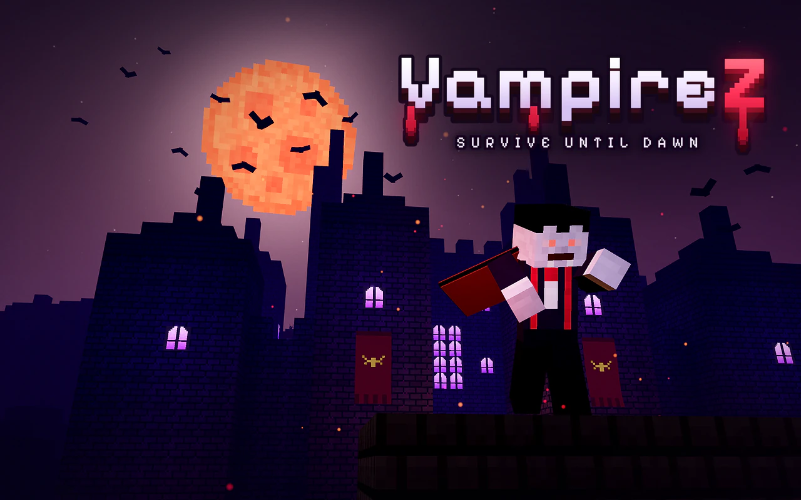

<p align="center">
  <a href="https://orbworlds.com/orb/vampirez?utm_source=github&utm_medium=readme&utm_campaign=vampirez"></a>
</p>

<h1 align="center">VampireZ</h1>

<p align="center">Survive one night against zombie waves and the vampires hunting you, in one HTML file. Get bitten and you join them.</p>

<p align="center">
  <a href="https://orbworlds.com/orb/vampirez?utm_source=github&utm_medium=readme&utm_campaign=vampirez"></a>
  &nbsp;
  <a href="https://orbworlds.com/orb/vampirez?remix&utm_source=github&utm_medium=readme&utm_campaign=vampirez"></a>
</p>

<p align="center"><b><a href="https://orbworlds.com/orb/vampirez?utm_source=github&utm_medium=readme&utm_campaign=vampirez">Play it now</a></b>: free, in your browser, on any device. No download, no account.</p>

---

Survive one night in a blocky village or in Frosthaven, a frozen harbour where a ghost ship lies locked in the ice: fight zombie waves, gear up and hold off the vampires until dawn. Get bitten and you join them. Between nights, walk Ravencross: quests, coffins, a daily reward, a monthly Blood Pass.

- **Two maps**: a blocky village, and Frosthaven, a frozen harbour with a ghost ship locked in the ice.
- Fight zombie waves, gear up and hold out **until dawn**, or hunt the survivors as a vampire.
- **Ravencross** between nights: quests, coffins, a daily reward and the Lantern Run.
- A monthly **Blood Pass**; capes, hats, outfits, kill effects, nameplates and titles in the wardrobe.

**Controls:** WASD to move, mouse to look, click to attack, right-click for the bow (or a bat dash), Shift to run, Space to jump, E for doors and keepers, B for the shop; as a vampire, F for bat form and Q to screech. Phones and tablets play by touch.

## Remix it

Every game on [Orb](https://orbworlds.com/?utm_source=github&utm_medium=readme&utm_campaign=vampirez) can be remixed, and this one is no exception. Two ways:

**By talking.** Open [VampireZ on Orb](https://orbworlds.com/orb/vampirez?remix&utm_source=github&utm_medium=readme&utm_campaign=vampirez), tap **Make my own copy**, and say what to
change: "make the nights longer", "add a dragon boss", "turn it into a pirate game". Orb's AI
builds it while you watch, and your version gets its own link to share.

**In code.** Fork this repository and play it on your machine:

```bash
git clone https://github.com/<you>/vampirez && cd vampirez
npm start            # http://127.0.0.1:4242 (Node 20+, nothing to install)
```

Open a second tab, or press **+ Player**, and you are two players in the same game. Edit
`index.html` and the page reloads. When you have pushed your changes, `npm run share` prints a
link that opens your version on Orb, as a world of your own, credited as a remix of VampireZ.

Made it better? Open a pull request: once it's merged here, it's live on Orb for everyone within
about a quarter of an hour.

## How it's made

The whole game is one file: `index.html`, 9,386 lines (767 KB) of HTML, CSS and
JavaScript, with [three.js](https://threejs.org) from a CDN. No build step, no dependencies.
It runs as an Orb world, using Orb's world SDK (`window.orb`, typed in
[`orb-kit/orb.d.ts`](orb-kit/orb.d.ts)):

- **Multiplayer** with `orb.room`: who is here, their state, messages
- **Invite links** with `orb.room.invite`, opening the game in the same room
- **Shared state** with `orb.store`: leaderboards and what everyone shares
- **A wardrobe** with `orb.shop`: looks bought with Orb credits (on Orb, what paid credits buy goes to the world’s maker)
- **Progress** in plain `localStorage`, which Orb saves per player and carries to their other devices

Outside Orb, `window.orb` doesn't exist, and the game still runs on its own: open `index.html`
in a browser for a single-player game. `npm start` runs it with the
[Orb kit](https://github.com/orbworlds/kit) instead, which gives it everything above on localhost.

## Contributing

This repository is where VampireZ is made: fixes, new content and ideas are welcome as pull requests
(see [CONTRIBUTING.md](CONTRIBUTING.md)). Every pull request runs the game's browser tests; merged,
it goes live on Orb by itself.

## License

The code is [MIT](LICENSE). It embeds the [Pixelify Sans](https://fonts.google.com/specimen/Pixelify+Sans)
font (SIL Open Font License 1.1, The Pixelify Sans Project Authors). The Orb name and logo aren't
covered by the license.

---

<p align="center">Made with <a href="https://orbworlds.com/?utm_source=github&utm_medium=readme&utm_campaign=vampirez"><b>Orb</b></a>: make games and worlds by talking, play them with friends, remix anyone's.</p>
