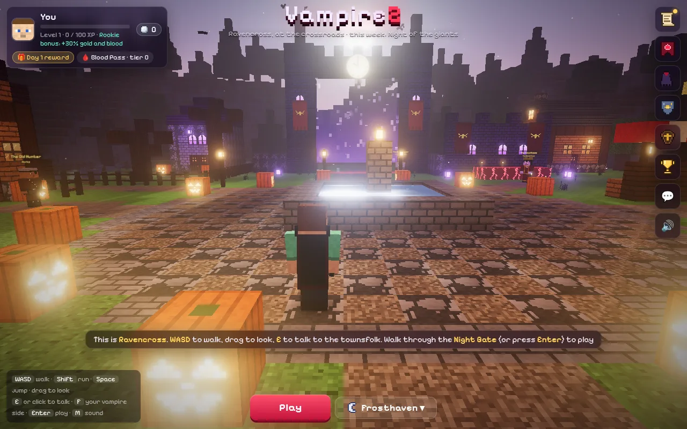
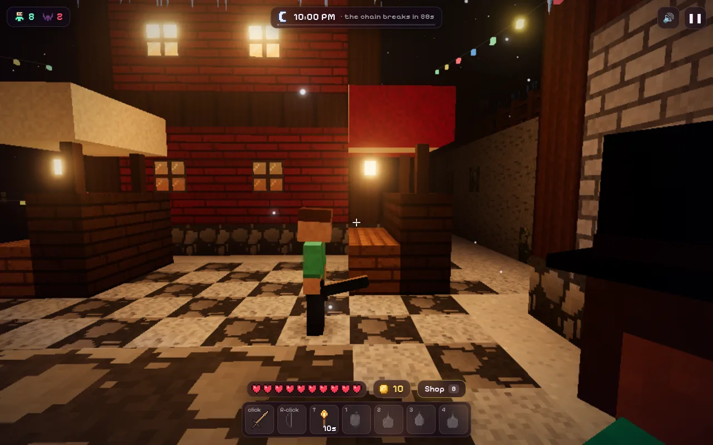

# VampireZ

<a href="https://orbworlds.com/orb/vampirez?utm_source=github&utm_medium=readme&utm_campaign=vampirez"></a>

The survivors have to make it to dawn. Zombies come in waves, and a few players start the night as vampires hunting everyone else. Whoever a vampire kills joins them, so there are fewer survivors as the night goes on.

There are two maps: a blocky village, and Frosthaven, a frozen harbour with a ghost ship stuck in the ice. Between nights you're in Ravencross, a town with quests, coffins to open, a daily reward and the Lantern Run.

**[Play it on Orb](https://orbworlds.com/orb/vampirez?utm_source=github&utm_medium=readme&utm_campaign=vampirez)**. It runs in the browser on a computer, phone or tablet, and you
don't need an account.

<p>
  
  
</p>

## Controls

WASD to move, mouse to look, click to attack, right click for the bow (or a bat dash as a vampire), Shift to run, Space to jump, E for doors and keepers, B for the shop. As a vampire, F turns you into a bat and Q screeches. On a phone or tablet it plays by touch.

## Run it yourself

```bash
git clone https://github.com/orbworlds/vampirez
cd vampirez
npm start
```

That opens it at http://127.0.0.1:4242 with the [Orb kit](https://github.com/orbworlds/kit),
which gives the game what it gets on Orb: other players (open a second tab, or press **+ Player**), saves, shared state and the shop, which charges nothing locally.
You need Node 20 or newer, and nothing else.

The whole thing is `index.html`, 9,386 lines of HTML, CSS and JavaScript with
[three.js](https://threejs.org) from a CDN. Edit it and the page reloads.

What it uses from Orb's world SDK (`window.orb`, typed in [`orb-kit/orb.d.ts`](orb-kit/orb.d.ts)):

- `orb.room` for multiplayer (who is here, what they are doing, messages between players)
- `orb.room.invite` for invite links that open the same room
- `orb.store` for things everyone shares, like scores
- `orb.shop` for the wardrobe, where looks are bought with Orb credits (the money from paid credits goes to the world’s maker)
- plain `localStorage` for progress, which Orb saves per player and brings along to their other devices

Outside Orb and the kit, `window.orb` isn't there and the game carries on without it.

## Make your own version

You can remix it on Orb without touching code: [open it there](https://orbworlds.com/orb/vampirez?remix&utm_source=github&utm_medium=readme&utm_campaign=vampirez), choose
**Make my own copy** and describe what you'd change. Orb's AI makes the changes in your copy.

Or fork this repository, make your changes and push them. `npm run share` then prints a link that
brings your fork into Orb as a world of your own, credited as a remix of this one, and it stays in
sync with your fork from then on.

## Contributing

Pull requests are welcome. GitHub checks each one by playing through the game in a headless browser,
and once a change is merged it's live on Orb within about 15 minutes. [CONTRIBUTING.md](CONTRIBUTING.md)
has the details.

## License

MIT, see [LICENSE](LICENSE). The page embeds the [Pixelify Sans](https://fonts.google.com/specimen/Pixelify+Sans) font, under the SIL Open Font License 1.1. The Orb name and logo aren't covered by the license.
